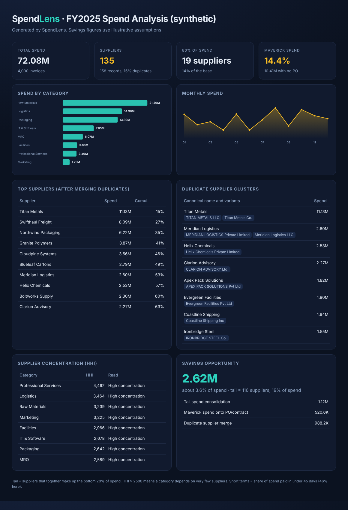

# SpendLens

[](https://github.com/HeASailor/spendlens/actions/workflows/ci.yml)   

**Procurement spend analytics in one command.** Point it at a spend CSV and get a single, self-contained HTML report: duplicate suppliers, Pareto and tail spend, maverick (no-PO) spend, category concentration, **auto-classified categories**, **price variance across suppliers** and an estimated savings opportunity.

No dependencies. No cloud. No data leaves your machine.



## Why

Every Source-to-Pay engagement starts the same way: someone exports a year of invoices, and the first week goes into cleaning supplier names and building the same five pivot tables. SpendLens automates that first pass so the conversation can start from the findings.

## Quick start

```bash
git clone https://github.com/HeASailor/spendlens && cd spendlens
pip install -e .

spendlens generate -o spend.csv            # synthetic data, or use your own
spendlens analyze spend.csv -o report.html
open report.html

spendlens classify spend.csv -o classified.csv   # just fill in missing categories
```

Prefer not to install? `python -m spendlens analyze spend.csv` works from the repo root.

## Input format

| column | required | notes |
|---|---|---|
| `supplier` | yes | raw supplier name as it appears in the ERP |
| `amount` | yes | invoice amount, any currency (commas are fine) |
| `category` | no | enables category and concentration views. Blanks are filled in automatically |
| `item` / `description` | no | free text used to auto-classify, and (`item`) to compare prices |
| `quantity` | no | with `unit_price` or `amount`, enables price variance |
| `unit_price` | no | if absent, `amount / quantity` is used |
| `date` | no | `YYYY-MM-DD`, enables the monthly trend |
| `po_number` | no | blank means no PO, which feeds maverick spend |
| `payment_terms_days` | no | enables the short-terms metric |

Rows with a missing supplier or a non-positive or unparseable amount are skipped.

## What it computes

- **Duplicate suppliers.** Names are normalised (case, punctuation, legal suffixes like *Pvt Ltd / LLC / GmbH*) and then fuzzy-matched. "ACME Packaging Pvt. Ltd." and "Acme Packaging Private Limited" become one supplier. Names that differ in their numbers are never merged, so "Vendor 127" and "Vendor 130" stay separate.
- **Pareto and tail spend.** How many suppliers make up 80% of spend, and how many sit in the bottom 20%.
- **Maverick spend.** Share of spend with no PO.
- **Concentration.** Herfindahl-Hirschman Index per category, so you can see where you depend on one or two suppliers.
- **Category auto-classification.** Blank categories are filled from supplier name, item and description. Pass one scores a weighted keyword taxonomy (8 categories) and abstains unless the winner has enough evidence and a clear margin. Pass two lets a still-blank row inherit its supplier's dominant category (60%+ of that supplier's spend). Categories you provide are never overwritten. Every guess gets a confidence score, and the report lists the weakest ones for review.
- **Price variance.** For each item bought from two or more merged suppliers (3+ invoices each), SpendLens takes every supplier's volume-weighted average price, uses the cheapest as the benchmark and sizes the gap: what you paid above buying every unit at the best price you have already achieved. The benchmark ignores spec, incoterms and quality, so read it as a lead, not a verdict.
- **Savings opportunity.** Tail consolidation, maverick-to-PO and duplicate-merge levers, each with a configurable assumption. Price harmonisation (default 40% of the price gap closed) joins the three levers when price columns exist.

> The savings figures are a **sizing exercise, not a forecast**. Defaults are 8% on tail spend, 5% on maverick spend and 3% on merged duplicates and 40% of the price gap. Levers can overlap, so read the total as an upper-end sizing. Replace them with your own benchmarks via `analyze(rows, assumptions={...})`.

## CLI

```
spendlens generate [-o spend.csv] [-n 4000] [--seed 42]
spendlens analyze  spend.csv [-o report.html] [--title "..."] [--units intl|indian] [--fuzzy 0.88]
                   [--no-classify] [--min-confidence 0.6]
spendlens classify spend.csv [-o classified.csv] [--min-confidence 0.6] [--overwrite]
```

`--units indian` formats numbers as Lakh and Crore.

## Use as a library

```python
from spendlens.analyze import load, analyze

a = analyze(load("spend.csv"))
print(a.unique_suppliers, a.maverick_pct, a.savings_total)
for canonical, variants, spend in a.duplicate_clusters[:5]:
    print(canonical, variants, spend)
for it in a.price_items[:3]:
    print(it.item, it.best_supplier, f"+{it.spread_pct:.0f}%", it.gap_value)
```

## Development

```bash
pip install -e ".[dev]"
pytest
```

## Roadmap

- [x] Category auto-classification from supplier and description text
- [x] Price-variance analysis across suppliers for the same item
- [ ] Custom taxonomy file for the classifier
- [ ] Price trend over time per item
- [ ] Contract coverage view (spend vs. active contracts)
- [ ] Excel export alongside HTML

## How good is the classifier?

Honest numbers, with caveats. On the synthetic file it recovers the blanked categories almost perfectly, but that text was written alongside the keywords, so it proves little. On a separate set of 34 hand-written, ERP-style lines (`tests/hand_labelled.py`, 4 of them deliberately unclassifiable) it gets all 34 right, but I wrote that set too and tuned one weight after a miss, so expect lower on your data. Keyword rules do not understand context: a supplier called "Cloud Nine Catering" will fight over it. Use `--min-confidence`, check the review table, and extend `TAXONOMY` in `spendlens/classify.py` for your own vocabulary.

## About the data

`docs/sample_spend.csv` is fully synthetic and seeded, so the screenshot is reproducible. It contains no real supplier, client or company data.

## License

MIT
