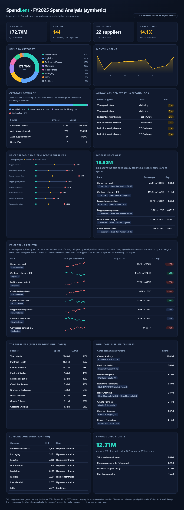

# SpendLens

[](https://github.com/HeASailor/spendlens/actions/workflows/ci.yml)   

**Procurement spend analytics in one command.** Point it at a spend CSV and get a single, self-contained HTML report: duplicate suppliers, Pareto and tail spend, maverick (no-PO) spend, category concentration, **auto-classified categories** (with your own category list if you have one), **price variance across suppliers**, **price trend per item**, **contract coverage** and an estimated savings opportunity. The findings also export to **Excel**.

No dependencies. No cloud. No data leaves your machine.



## Why

Every Source-to-Pay engagement starts the same way: someone exports a year of invoices, and the first week goes into cleaning supplier names and building the same five pivot tables. SpendLens automates that first pass so the conversation can start from the findings.

## Quick start

```bash
git clone https://github.com/HeASailor/spendlens && cd spendlens
pip install -e .

spendlens generate -o spend.csv            # synthetic data, or use your own
spendlens analyze spend.csv -o report.html
open report.html

spendlens classify spend.csv -o classified.csv   # just fill in missing categories

spendlens taxonomy -o my_categories.csv         # export the built-in category list, edit it
spendlens analyze spend.csv --taxonomy my_categories.csv

spendlens generate -o spend.csv --contracts contracts.csv      # demo spend and contract list
spendlens analyze spend.csv --contracts contracts.csv --excel findings.xlsx
```

Prefer not to install? `python -m spendlens analyze spend.csv` works from the repo root.

## Input format

| column | required | notes |
|---|---|---|
| `supplier` | yes | raw supplier name as it appears in the ERP |
| `amount` | yes | invoice amount, any currency (commas are fine) |
| `category` | no | enables category and concentration views. Blanks are filled in automatically |
| `item` / `description` | no | free text used to auto-classify, and (`item`) to compare prices |
| `quantity` | no | with `unit_price` or `amount`, enables price variance |
| `unit_price` | no | if absent, `amount / quantity` is used |
| `date` | no | `YYYY-MM-DD`, enables the monthly spend chart and, with prices, the price trend per item |
| `po_number` | no | blank means no PO, which feeds maverick spend |
| `payment_terms_days` | no | enables the short-terms metric |

Rows with a missing supplier or a non-positive or unparseable amount are skipped.

## What it computes

- **Duplicate suppliers.** Names are normalised (case, punctuation, legal suffixes like *Pvt Ltd / LLC / GmbH*) and then fuzzy-matched. "ACME Packaging Pvt. Ltd." and "Acme Packaging Private Limited" become one supplier. Names that differ in their numbers are never merged, so "Vendor 127" and "Vendor 130" stay separate.
- **Pareto and tail spend.** How many suppliers make up 80% of spend, and how many sit in the bottom 20%.
- **Maverick spend.** Share of spend with no PO.
- **Concentration.** Herfindahl-Hirschman Index per category, so you can see where you depend on one or two suppliers.
- **Category auto-classification.** Blank categories are filled from supplier name, item and description. Pass one scores a weighted keyword taxonomy (8 categories) and abstains unless the winner has enough evidence and a clear margin. Pass two lets a still-blank row inherit its supplier's dominant category (60%+ of that supplier's spend). Categories you provide are never overwritten. Every guess gets a confidence score, and the report lists the weakest ones for review. Bring your own category list with `--taxonomy` (see below).
- **Price variance.** For each item bought from two or more merged suppliers (3+ invoices each), SpendLens takes every supplier's volume-weighted average price, uses the cheapest as the benchmark and sizes the gap: what you paid above buying every unit at the best price you have already achieved. The benchmark ignores spec, incoterms and quality, so read it as a lead, not a verdict.
- **Price trend per item.** For items with dated, priced invoices in at least 4 months (2+ invoices each), SpendLens builds a unit-price series and compares the first third of the periods with the last third. The headline change is **like-for-like**: only suppliers that sold the item in both windows, each compared with itself, weighted by late volume. That way moving volume from a cheap supplier to a dear one does not show up as a price rise. When the all-supplier average disagrees by 5 points or more, the report tags the item so you can see the mix effect. Items are ranked by cost impact, and `--trend-period quarter` is there for thinner data.
- **Contract coverage.** With a contract list, each invoice is marked covered, outside contract dates or no contract. The report shows coverage, the top uncovered suppliers and contracts about to expire (see below).
- **Savings opportunity.** Tail consolidation, maverick-to-PO and duplicate-merge levers, each with a configurable assumption. Price harmonisation (default 40% of the price gap closed) joins the three levers when price columns exist.

> The savings figures are a **sizing exercise, not a forecast**. Defaults are 8% on tail spend, 5% on maverick spend and 3% on merged duplicates and 40% of the price gap. Levers can overlap, so read the total as an upper-end sizing. Replace them with your own benchmarks via `analyze(rows, assumptions={...})`.

## CLI

```
spendlens generate [-o spend.csv] [-n 4000] [--seed 42] [--contracts FILE]
spendlens analyze  spend.csv [-o report.html] [--title "..."] [--units intl|indian] [--fuzzy 0.88]
                   [--no-classify] [--min-confidence 0.6]
                   [--taxonomy FILE] [--taxonomy-mode extend|replace] [--trend-period month|quarter]
                   [--contracts FILE] [--excel FILE]
spendlens classify spend.csv [-o classified.csv] [--min-confidence 0.6] [--overwrite]
                   [--taxonomy FILE] [--taxonomy-mode extend|replace]
spendlens taxonomy [-o taxonomy.csv]
```

`--units indian` formats numbers as Lakh and Crore.

## Your own category list

Use your category names and vocabulary instead of editing the source. `spendlens taxonomy` writes the built-in list as a CSV you can open in Excel. Or start from `docs/example_taxonomy.csv`:

```csv
category,keyword,weight
Safety & PPE,glove,4
Safety & PPE,helmet,4
Cloud & Hosting,cloud,4
Packaging,gunny bag,2
```

A JSON file works too: `{"Safety & PPE": ["glove", "helmet"], "Packaging": {"gunny bag": 2}}`.

- **Extend or replace.** By default your file is added to the built-in list: matching category names (case does not matter) get your keywords, new names become new categories, and a keyword you repeat overrides its built-in weight. `--taxonomy-mode replace` uses only your file.
- **Weights** run from 1 (weak hint) to 5 (decisive), default 3. A category needs a score of 3 and a clear lead to win, so a single keyword at 3 or more is enough on its own.
- **Matching.** A word matches a keyword if it starts with it, so `glove` also catches "gloves". Keywords under 4 characters must match the whole word, and multi-word keywords match as a phrase.
- **Never overwrites.** Categories already in your spend file stay as they are. Your list only fills blanks, so a new category will look small until blanks are routed to it. Use `classify --overwrite` if you want existing rows re-labelled too.

## Contract coverage

Pass a contract list with `--contracts`. Start from `docs/sample_contracts.csv`:

| column | required | notes |
|---|---|---|
| `supplier` | yes | matched to spend suppliers by the same name rules used to merge duplicates |
| `start_date` | yes | `YYYY-MM-DD` |
| `end_date` | yes | `YYYY-MM-DD`, the last day covered |
| `category` | no | limits the contract to that category (case does not matter). Blank covers everything from the supplier |
| `contract_id` | no | shown in the report and export |

| status | meaning |
|---|---|
| covered | a contract in scope was live on the invoice date |
| outside contract dates | the supplier has a contract in scope, but not live on that date |
| no contract | nothing in your list for that supplier, or for that supplier and category |
| undated | the supplier has a contract in scope, but the invoice date cannot be read |

- **Expiring** means ending within 90 days of the latest invoice date in your file, not of today. Contracts with a follow-on contract of the same scope are left out.
- **Check the names.** Contracts that match no supplier are listed. A badly shortened name in the spend file may not match, and will show as uncovered.
- **Covered is not compliant.** It means a contract existed. Price, terms and volume are not checked.
- Coverage is not added to the savings total, because it overlaps with no-PO spend.

## Excel export

`--excel findings.xlsx` writes the full lists behind the report, with filters and a frozen header row:

| sheet | contents |
|---|---|
| Summary | headline numbers |
| Duplicate suppliers | every name variant in each merged cluster |
| Price gaps | every supplier price point for each compared item |
| Price trends | every item with enough history |
| Category review | every low-confidence category guess |
| Contract coverage, Expiring contracts, Unmatched contracts | with `--contracts` (the last only if any are unmatched) |
| Savings levers | assumptions are shaded cells; change them and the totals recalculate |

No extra packages are needed. Amounts are plain numbers, whatever `--units` is set to.

## Use as a library

```python
from spendlens.analyze import load, analyze

a = analyze(load("spend.csv"))
print(a.unique_suppliers, a.maverick_pct, a.savings_total)
for canonical, variants, spend in a.duplicate_clusters[:5]:
    print(canonical, variants, spend)
for it in a.price_items[:3]:
    print(it.item, it.best_supplier, f"+{it.spread_pct:.0f}%", it.gap_value)
for t in a.trend_items[:3]:
    print(t.item, f"{t.change_pct:+.1f}%", t.basis, t.early_span, "vs", t.late_span)

# your own categories
from spendlens.classify import TAXONOMY
from spendlens.taxonomy import load_taxonomy, merge_taxonomy
tax = merge_taxonomy(TAXONOMY, load_taxonomy("my_categories.csv"))
a = analyze(load("spend.csv"), taxonomy=tax)
```

## Development

```bash
pip install -e ".[dev]"
pytest
```

## Roadmap

- [x] Category auto-classification from supplier and description text
- [x] Price-variance analysis across suppliers for the same item
- [x] Custom taxonomy file for the classifier
- [x] Price trend over time per item
- [x] Contract coverage view (spend vs. active contracts)
- [x] Excel export alongside HTML
- [ ] Savings tracker, from identified opportunity to realised
- [ ] Supplier scorecard

## How good is the classifier?

Honest numbers, with caveats. On the synthetic file it recovers the blanked categories almost perfectly, but that text was written alongside the keywords, so it proves little. On a separate set of 34 hand-written, ERP-style lines (`tests/hand_labelled.py`, 4 of them deliberately unclassifiable) it gets all 34 right, but I wrote that set too and tuned one weight after a miss, so expect lower on your data. Keyword rules do not understand context: a supplier called "Cloud Nine Catering" will fight over it. Use `--min-confidence`, check the review table, and add your own vocabulary with `--taxonomy`.

## Reading the price trend

- The change compares the **first and last third** of the periods, not a year-on-year rate. On 12 months of data that is roughly 8 months apart, so it will understate an annual move.
- Like-for-like needs a supplier that sold the item in both windows. If none did, the report falls back to the all-supplier average and says so.
- It does not know about spec changes, delivery terms, currency moves or quality. An item that is bought in different units under one name will give nonsense. Check the series before acting on it.
- On the synthetic file the drift is planted, so the trend recovers it by construction. It shows the method works, not how it will behave on your data.

## About the data

`docs/sample_spend.csv` and `docs/sample_contracts.csv` are fully synthetic. The screenshot is built from these two files. Prices drift by an invented rate per item across the year so the trend view has something to find. They contain no real supplier, client or company data.

## License

MIT
